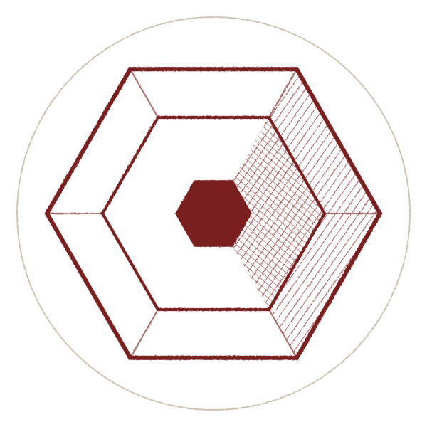

<picture>
  <source media="(prefers-color-scheme: dark)" srcset="./assets/cirwel-device-dark.svg">
  
</picture>

## CIRWEL

**Infrastructure for long-lived AI agents.**

CIRWEL builds systems for agent work across sessions, runtimes, and vendors.

The main project is **[UNITARES](https://github.com/cirwel/unitares)**, accountability infrastructure for long-running AI agents: a self-hosted, single-operator federation kernel that keeps one attributed record of identity, claims and evidence, review, outcomes, and reconstruction across those boundaries, alongside Git, handoff notes, and scratchpads.

### Start here

**[UNITARES](https://github.com/cirwel/unitares)**  
Accountability infrastructure for long-running AI agents. Self-hosted MCP and REST server, SDK, shared memory, cross-vendor review, outcomes, and recovery.  
[Install](https://github.com/cirwel/unitares#install) (Homebrew preview for Apple Silicon Macs or release-tagged Docker Compose) · [Walkthrough](https://cirwel.github.io/unitares/demo.html) · [Evidence and limits](https://github.com/cirwel/unitares/blob/master/docs/EVIDENCE_AND_LIMITS.md)

**[unitares-sdk](https://pypi.org/project/unitares-sdk/)**  
The public agent-side contract.

```bash
pip install unitares-sdk
```

**[Host adapter](https://github.com/cirwel/unitares-host-adapter)** and **[plugin](https://github.com/cirwel/unitares-governance-plugin)**  
Connect existing harnesses such as Claude Code, Codex, and Hermes without moving the agent loop.

### Research

CIRWEL studies longitudinal runtime state estimation, behavioral trajectory identity, and verifiable attestation across agent fleets:

- [UNITARES: Information-Theoretic Governance of Heterogeneous Agent Fleets](https://doi.org/10.5281/zenodo.19647159)
- [Trajectory Identity](https://doi.org/10.5281/zenodo.20098168)
- [A Flat Coherence Score](https://doi.org/10.5281/zenodo.21930092)
- [Accountability Without a Trusted Center](https://doi.org/10.5281/zenodo.21930161)
- [Datasets and reproduction kits](https://huggingface.co/hikewa)

### Built under its own machinery

CIRWEL uses UNITARES in its own development environment.

Agents working on the stack use attributed shared memory, advisory consultation, structured review, evidence-linked check-ins, and surface leases alongside Git and handoff notes. Advice remains evidence rather than automatically becoming authority.

The deployment has run since November 2025 as CIRWEL's own development record; operational figures and scope live in the [production snapshot](https://github.com/cirwel/unitares/blob/master/docs/PRODUCTION_SNAPSHOT.md) and [evidence ledger](https://github.com/cirwel/unitares/blob/master/docs/EVIDENCE_AND_LIMITS.md).

### Elsewhere

[cirwel.org](https://cirwel.org) · [Research index](https://cirwel.github.io) · [Hugging Face](https://huggingface.co/hikewa) · founder@cirwel.org
